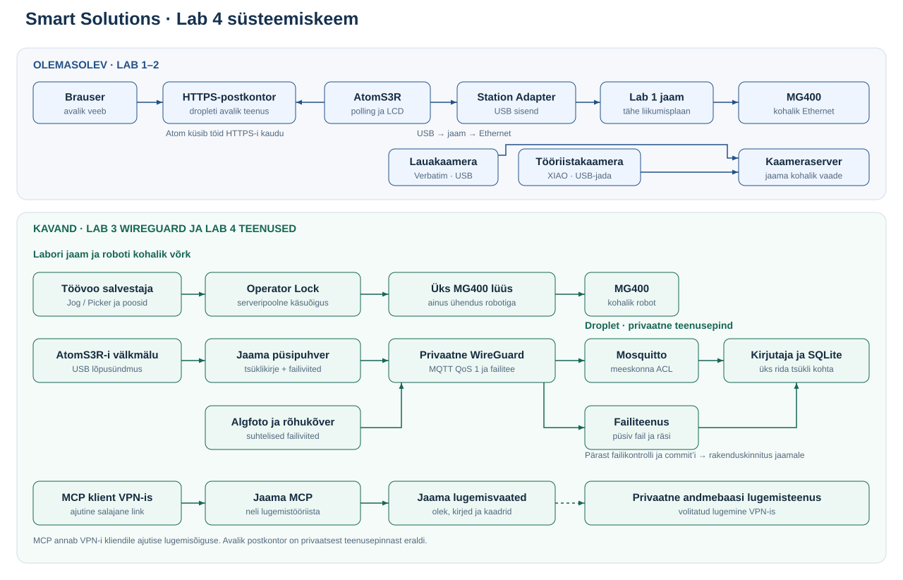

# Süsteemi arhitektuur

[Muudetav draw.io skeem](system.drawio)

## Olemasolev lähtekoht

- **Lab 1:** kohalik jaam teisendab tähetöö MG400 liikumisplaaniks. Roboti ühendus käib selle kohaliku võrguga. Olemasolev baaspakett võimaldab punkte õpetada ja proovida.
- **Lab 2:** avalik postkontor võtab brauserist whitelist'i töid. AtomS3R algatab väljuva HTTPS pollingu. LCD kuvab pilditööd kohapeal. Tähetöö liigub USB kaudu Station Adapterisse, sealt Lab 1 jaama ja MG400-ni. Jaama kaameralehel on Verbatim USB lauakaamera ja 15.11 katses USB-jadaühendusega XIAO tööriistakaamera. Avalik teenus jääb kohalikest kaameratest ja robotivõrgust eraldi. [15.11 Lab 2 tõendid](https://github.com/Dennel04/smart-solutions-course/blob/3d3743326901ca48b8f9d1868fce8b4ed3d90f69/smart-solutions/lab2/README.md#praegune-seis-15112026)
- **Lab 3:** privaatne WireGuardi tee dropleti ja labori vahel on [plaan](../../lab3/docs/network_plan.md). Päris tunnel, 48 tunni seire, katkestuse ohutu käitumine, UV ja klapp vajavad veel füüsilisi katseid.

## Lab 4 kavandatud täiendused

1. **Kirje.** Jaam eraldab võtme ja võtab vastu Atomi püsivalt talletatud lõpusündmuse. Jaama püsipuhver seob sündmuse Andmehõive mõõtmiste, foto ja rõhukõveraga. Foto ja kõver liiguvad privaatsesse failihoidlasse, kirje QoS 1 MQTT kaudu Mosquitto brokerisse. Dropleti kirjutaja salvestab kirje SQLite'i ja kinnitab selle jaamale pärast failide ning salvestuse kontrolli. [Kirje](record.md) · [MQTT](mqtt.md) · [Püsipuhver](buffering.md) · [Andmebaas](database.md)
2. **Liikumine.** Töövoo salvestaja kasutab jaama kaameravaateid ning olemasolevaid poosiandmeid ja õpetamise töövõtteid Lab 1-st ja CAD Hubist. Operator Lock kontrollib kasutajat ja käsuõigust jaamas. Üks kohalik MG400 lüüs omab päris käsuühendust ja lubab terve jada. Avaliku tee lubatud Lab 2 robotitöö peab läbima sama lüüsi. [Integratsioon](integration.md) · [Töövoog](workflow.md) · [Operaatorilukk](operator_lock.md)
3. **Vaatlus.** Kaitstud jaama lehte saab kavandi järgi avada LAN-is või VPN-is. MCP on kättesaadav ainult VPN-is ja ainult avatud ajutise lingiga. Kaamerad ning eksperimendi andmed jäävad privaatsesse võrku. Avaliku postkontori protsessil puudub ligipääs juhtimisele, katse-MQTT-le, katsebaasile ja kaameratele. [MCP](mcp.md) · [Ohutus](safety.md)

Dropletil on kaks eraldi teenusepinda. Avalik HTTPS-postkontor teenindab Lab 2 töid. VPN-i poolel on Mosquitto, failiteenus ja ligipääs ühise katsebaasi lugemisvaatele. SQLite ja kirjutaja töötavad lokaalselt dropletil. Tunneli tegelikud marsruudid, kuulamisaadressid ja võrgu eraldus kinnitatakse Lab 3 töö käigus.
